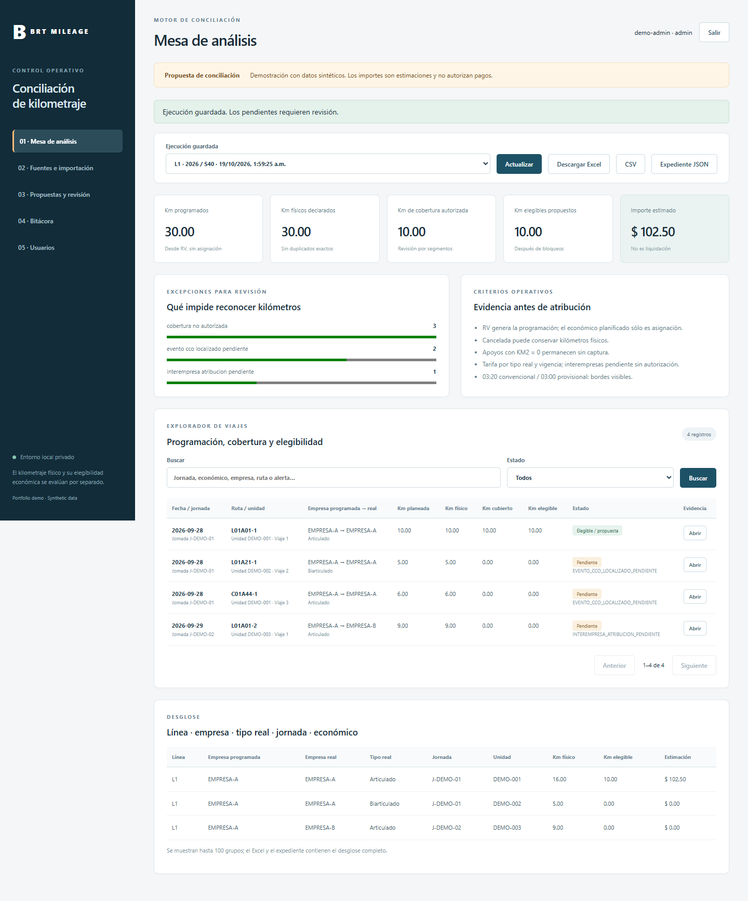

# BRT Mileage Reconciliation Engine

[](https://github.com/dekelmordejai/brt-mileage-reconciliation-engine/actions/workflows/engine-ci.yml)
[Español](README.es.md) · [Architecture](docs/architecture.md) · [Run the demo](docs/demo.md) · [Scope & limitations](docs/status.md)

**An evidence-oriented application for reconciling scheduled bus mileage, reported execution, reviewed coverage and economic eligibility.** Built with Python, FastAPI, SQLite and a browser-based analyst workspace.

This public edition is an independent engineering portfolio demonstration. Every committed record and screenshot is synthetic. It is not an official product of a transit agency, is not endorsed by an operator and does not execute payments. The public repository starts from a reviewed snapshot; private operational history, issues, case studies and datasets are not part of this edition.

## The engineering problem

Different reports can describe the same physical journey. A cancelled administrative trip may still contain physical mileage; a substitute vehicle may have a different tariff; missing documentation should hold the affected segment without deleting the distance. Simply summing spreadsheets can double-count work or turn missing evidence into an unsupported financial conclusion.

This project keeps four distinct quantities: **scheduled → physically reported → reviewed coverage → economically eligible proposal**. Evidence, uncertainty and approval remain visible throughout the workflow.

## What you can inspect

| Area | Implemented behavior |
|---|---|
| Ingestion | CSV/XLSX/JSON adapters, row validation/quarantine, original bytes and SHA-256 provenance, idempotent reimport |
| Reconciliation | Schedule derived from trip reports; conservative stop-checkpoint candidates; explicit date boundaries; exact-duplicate and vehicle-overlap controls |
| Segment review | Measured segment proposals, disjoint kilometer ranges, localized documentary holds and versioned corrections |
| Economic proposal | Actual-vehicle classification, date-effective tariffs, blocked ambiguous rates and unresolved cross-company attribution |
| Analyst workspace | Search, trip evidence, source versions, grouped results and Excel/CSV/JSON exports |
| Governance | Persistent users/roles, separate proposer/reviewer, immutable result snapshots and hash-linked audit history |
| Delivery | Python package and CLI, local startup scripts, Docker Compose and GitHub Actions |



## Try it locally

Python 3.12 recommended. The interface is in Spanish; the architecture and public documentation are available in English.

```sh
python -m venv .venv
# Activate .venv using your operating system's usual command.
python -m pip install -r requirements.txt
python -m app.cli demo
python -m uvicorn app.main:app --host 127.0.0.1 --port 8000
```

Open [localhost:8000](http://127.0.0.1:8000). Demo users: `demo-admin`, `demo-analista`, `demo-revisor`. Demo-only password: `Demo-local-2026!`. Initialize the demo only in an empty database. Never use these publicly documented accounts with real information.

Windows shortcut: `.\scripts\start.ps1 -Demo`. The complete Linux/macOS, Windows, Docker and reviewer walkthrough is in [the demo guide](docs/demo.md).

## Verification

The reviewed baseline has **52 passing automated tests and 3 explicitly skipped design questions**, plus an end-to-end browser workflow. The CI badge reports the current public revision; test counts are not a production accuracy claim.

```sh
python -m pip install -r requirements-dev.txt
python -m pip install -e .
python -m pytest
python -m ruff check app src tests scripts
python -m ruff format --check app src tests scripts
python -m build
```

Browser acceptance covers upload → processing → search → evidence → proposal → second-person decision → reprocessing → Excel → audit verification. CI checks Python 3.11–3.13, browser acceptance and Docker image construction. It does not deploy an app or process operational data.

## Design decisions worth reviewing

- Original sources and approved decisions are append-only; corrections reference a previous version.
- Candidate matching is deliberately conservative and never authorizes payment by itself.
- Monetary and kilometer calculations use Decimal; contractual rounding remains a separate unconfirmed policy.
- An evidence row cannot authorize two active trip claims; selected-source provenance is checked again on each run.
- Holds can be localized to measured, timed segments without subtracting physical mileage or extrapolating distance from average speed.
- Cross-company attribution, missing/overlapping tariffs and uncertain operational-day boundaries remain blocked.

See [architecture and data flow](docs/architecture.md), [source contracts](docs/source-contracts.md) and [security boundaries](SECURITY.md).

## Honest scope

The local review workflow is executable. Automatic spatial reconstruction, contractual settlement/rounding and organization-specific acceptance remain unresolved. SQLite targets a single local service; enterprise identity, high availability and production deployment are outside this demonstration. No savings, production adoption, independent physical validation or financial accuracy is claimed.

## Portfolio context

Maintained by [dekelmordejai](https://github.com/dekelmordejai). The repository demonstrates data modeling, heterogeneous ingestion, evidence provenance, conservative domain logic, authorization, full-stack integration and reproducible testing. [A concise project description for a CV](docs/portfolio.md) is provided in English and Spanish.

**Rights:** public for portfolio review; no open-source license is granted. See [LICENSE.md](LICENSE.md). Dependencies retain their respective licenses.
