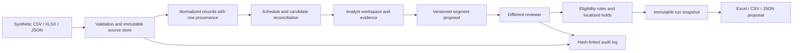

# Architecture

The application separates source identity, physical reporting, reviewed coverage and financial eligibility. It is designed to retain uncertainty rather than silently force a match.

| Module | Responsibility |
|---|---|
| `app/importers.py` | Original-file parsing, field normalization, Decimal values, dates and row validation |
| `app/store.py` | SQLite schema, source/record/run/proposal/decision persistence, append-only guards and audit chain |
| `app/engine.py` | Candidate association, program/physical distinction, evidence exclusivity, holds, tariffs and grouped results |
| `app/security.py` | Password hashing and constant-time verification |
| `app/main.py` | Typed API, session/CSRF/role enforcement, review decisions and exports |
| `app/static/` | Analyst workspace, source inventory, evidence viewer and review queue |
| `src/brt_reconciliation/` | Installable CLI and immutable matching primitives with explicit synthetic contracts |

`sources` stores original bytes and hashes; `records` stores original/normalized row representations. `proposals` and `decisions` preserve revisions and identities. `runs` stores the selected sources, engine version and full immutable result. `users` and expiring `sessions` authorize actions. `audit` links each event to its predecessor hash.

Source, record, run, proposal, decision and audit tables reject UPDATE/DELETE through SQLite triggers. This is an application safeguard and tamper-evidence mechanism, not protection from an administrator who can replace the database or remove triggers.

Candidate links require compatible date/vehicle/duty and checkpoint timing; temporal and kilometer consistency are not independent proof of physical execution. Uncertain associations remain visible. Reviewed ranges cannot overlap or exceed reported physical mileage. Documentary events hold only affected trips/segments; missing times do not justify inventing a distance. Effective tariffs depend on the executing vehicle classification and date. Financial outputs are proposals, never settlement instructions.

The deployment target is one localhost service with one worker and a persistent private SQLite volume. No cloud account, external API key or operational dataset is required for the demo.
